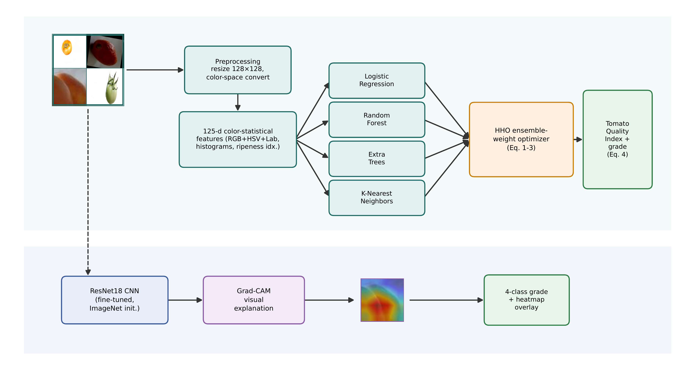
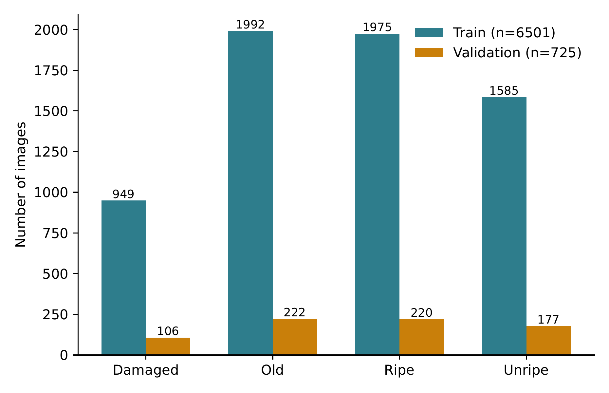
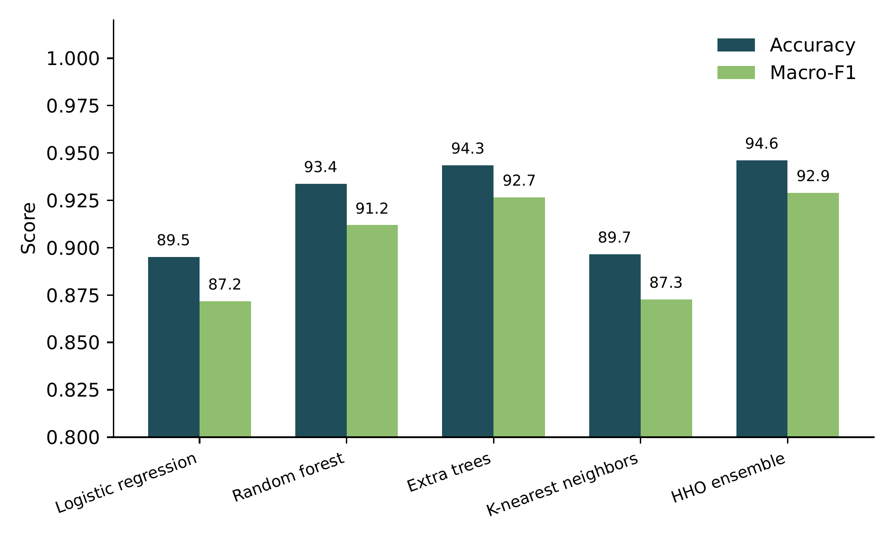
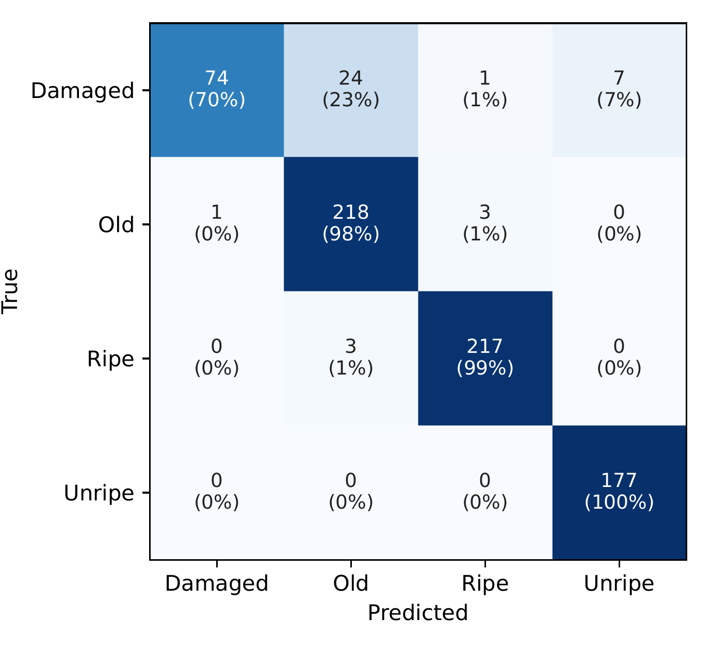
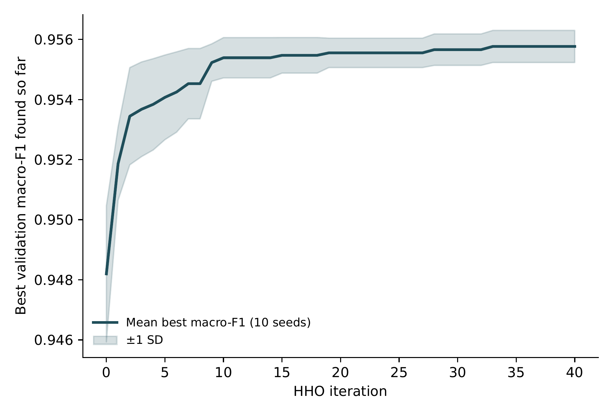
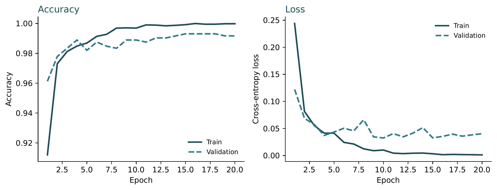
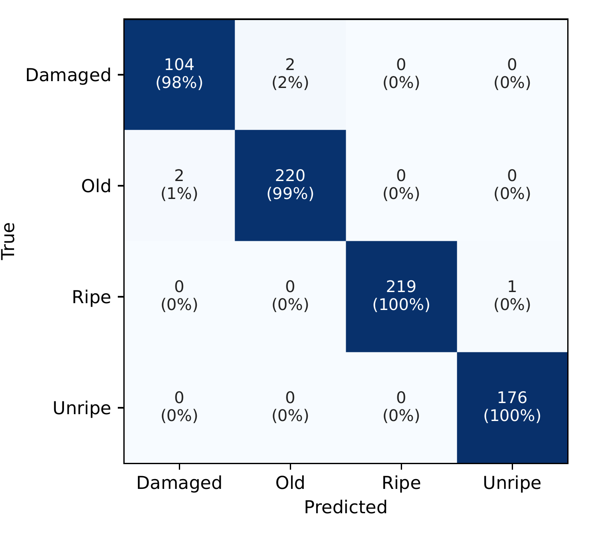
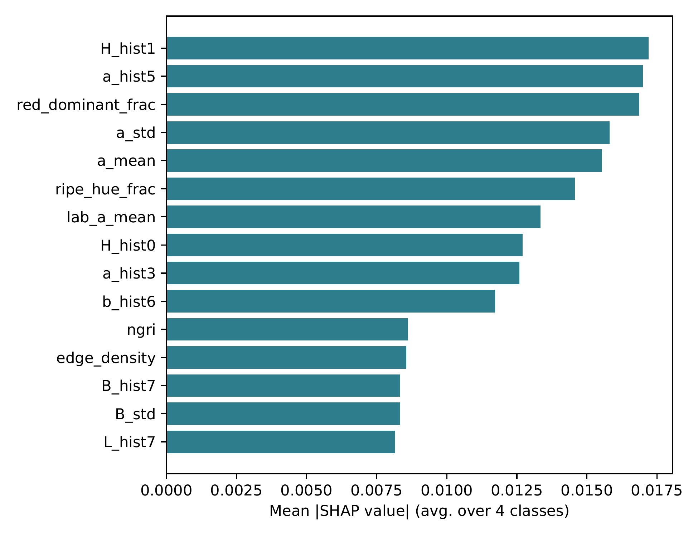
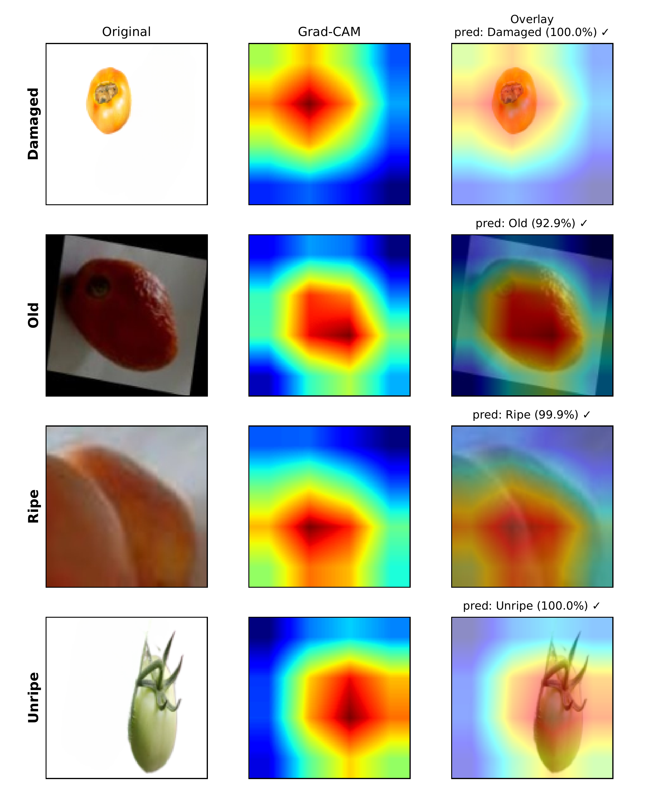

<div align="center">

# HHO-Tomato-Quality-Index

**Harris Hawks Optimization–Optimized Explainable Quality Index for Tomato Grading**

Van Van Chau<sup>1</sup> · Phayung Meesad<sup>2,*</sup> · Minh Tuan Nguyen<sup>1</sup>

<sup>1</sup> Faculty of Information Technology, Posts and Telecommunications Institute of Technology, Vietnam<br>
<sup>2</sup> Department of Information Technology Management, King Mongkut's University of Technology North Bangkok, Thailand<br>
<sup>*</sup> Corresponding author

*Journal of Data Science and Intelligent Systems*, Bon View Publishing. Published online 10 November 2026.

[Article page](https://ojs.bonviewpress.com/index.php/jdsis/article/view/11565) · [DOI: 10.47852/bonviewJDSIS620211565](https://doi.org/10.47852/bonviewJDSIS620211565)


[](https://doi.org/10.47852/bonviewJDSIS620211565)

</div>

**Contents:** [Abstract](#abstract) · [Contributions](#contributions) · [Framework](#framework) · [Data and protocol](#data-and-protocol) · [Results](#results) · [Paired tests](#paired-tests) · [Timing](#timing) · [Explainability](#explainability) · [Reproducing](#reproducing) · [Scripts](#scripts) · [Repository layout](#repository-layout) · [Data and license](#data-and-license) · [Citation](#citation) · [Contact](#contact)

## Abstract

Automated tomato ripeness and quality grading is essential for precision agriculture and industrial packing lines, replacing slow, subjective manual sorting. Most reported systems, however, rely on heavy deep networks or a single accuracy figure without ablation, statistical validation, or an explicit accuracy–interpretability–latency trade-off. This study proposes HHO-XQI, a Harris Hawks Optimization (HHO)-optimized Explainable Quality Index that fuses interpretable color-statistical features into a continuous Tomato Quality Index for four-class grading (Damaged, Old, Ripe, Unripe). The framework extracts 125 RGB/HSV/Lab color-statistical descriptors, fuses four base learners (logistic regression, random forest, extra trees, k-nearest neighbors) via HHO-optimized soft voting on 7,226 images, and is benchmarked against a fine-tuned ResNet18 CNN with Gradient-weighted Class Activation Mapping (Grad-CAM). Evaluation combined held-out accuracy/macro-F1, repeated cross-validation with Holm-corrected Wilcoxon tests, feature- and ensemble-composition ablation, HHO sensitivity/convergence analysis, SHapley Additive exPlanations (SHAP) attribution, and latency/training-time profiling. HHO-XQI reached 94.62% accuracy (92.90% macro-F1), significantly beating three baselines (p < 10<sup>−4</sup>) but not extra trees alone (p = 0.071); the CNN reached 99.31% accuracy at comparable CPU latency (11.31 vs. 12.05 ms) yet required approximately 147× longer training (575.7 vs. 3.92 s). These findings support a two-tier deployment: HHO-XQI as a near-instantly retrainable, SHAP-native first-stage screener, and the CNN + Grad-CAM branch as a slower-to-retrain but more accurate second-stage auditor. The study contributes a statistically validated, fully reproducible metaheuristic-fused explainable grading pipeline that fills a rigor gap common in agricultural swarm-intelligence literature.

## Contributions

1. **Grading pipeline.** A complete, reproducible grading pipeline for the Damaged, Old, Ripe, and Unripe tomato classes, built on 125 interpretable color-statistical descriptors extracted from the RGB, HSV, and Lab color spaces.
2. **HHO fusion and quality index.** HHO jointly optimizes soft-voting fusion weights across four heterogeneous base learners and constructs the Tomato Quality Index, a continuous, explainable score that ranks samples by predicted grade risk rather than returning only a class label.
3. **Statistical validation.** Repeated stratified cross-validation with Holm-corrected Wilcoxon signed-rank tests, a two-axis ablation study, an HHO hyperparameter sensitivity analysis, a convergence study, and a SHAP feature-attribution analysis.
4. **CNN benchmark.** A fine-tuned ResNet18 CNN with Grad-CAM, trained on the same data as an independent explainability channel and accuracy/latency benchmark, enabling an industrial two-tier deployment scenario that pairs fast screening with CNN-based auditing.

**Table 1.** Positioning of HHO-XQI against the closest related work. ✓ = yes, ✗ = no, ∂ = partial.

| Study | Swarm | Stat. | Abl. | XAI | Multi-branch |
|:--|:--:|:--:|:--:|:--:|:--:|
| Shrivastav et al. | ✓ | ✗ | ∂ | ✗ | ✗ |
| Rajalaxmi et al. | ✓ | ✗ | ✗ | ✗ | ✗ |
| Malini et al. | ✓ | ✗ | ✗ | ✗ | ✗ |
| Quach et al. | ✗ | ✗ | ✗ | ✓ | ✗ |
| Tomas et al. | ✗ | ✗ | ✗ | ✗ | ∂ |
| HHO-XQI, this work | ✓ | ✓ | ✓ | ✓ | ✓ |

## Framework

<p align="center"></p>

<p align="center"><b>Figure 1.</b> System architecture of the proposed framework, with the parallel CNN+Grad-CAM benchmark branch</em> [<a href="figures/fig1_architecture.pdf">PDF</a>]</p>

## Data and protocol

The Tomatoes dataset holds 7,226 RGB images in four classes. Its publisher-defined train and validation partition was kept without re-shuffling. Images are resized to 128 × 128 pixels during preprocessing.

**Table 2.** Dataset class distribution

| Class | Train | Validation | Total |
|:--|--:|--:|--:|
| Damaged | 949 | 106 | 1,055 |
| Old | 1,992 | 222 | 2,214 |
| Ripe | 1,975 | 220 | 2,195 |
| Unripe | 1,585 | 177 | 1,762 |
| Total | 6,501 | 725 | 7,226 |

<p align="center"></p>

<p align="center"><b>Figure 2.</b> Dataset class distribution by split [<a href="figures/fig2_dataset_distribution.pdf">PDF</a>]</p>

## Results

**Table 3.** Held-out validation performance, N = 725

| Model | Accuracy | Precision | Recall | Macro-F1 |
|:--|--:|--:|--:|--:|
| Logistic regression | 0.8952 | 0.8827 | 0.8654 | 0.8717 |
| Random forest | 0.9338 | 0.9449 | 0.8988 | 0.9119 |
| Extra trees | 0.9434 | 0.9525 | 0.9144 | 0.9266 |
| K-nearest neighbors | 0.8966 | 0.8954 | 0.8628 | 0.8727 |
| HHO-XQI | 0.9462 | 0.9551 | 0.9166 | 0.9290 |

**Table 4.** HHO-optimized fusion weights

| Base learner | Fusion weight |
|:--|--:|
| Extra trees | 0.8721 |
| Random forest | 0.0612 |
| Logistic regression | 0.0590 |
| K-nearest neighbors | 0.0077 |

<p align="center"></p>

<p align="center"><b>Figure 3.</b> Model comparison on the held-out validation split [<a href="figures/fig3_model_comparison.pdf">PDF</a>]</p>

<p align="center"></p>

<p align="center"><b>Figure 4.</b> HHO-XQI confusion matrix, held-out validation split [<a href="figures/fig4_confusion_matrix_hho.pdf">PDF</a>]</p>

**Table 7.** Feature-space ablation, HHO-XQI on held-out validation

| Feature set | Dimensions | Accuracy | Macro-F1 |
|:--|--:|--:|--:|
| RGB only | 36 | 0.9186 | 0.8995 |
| RGB + HSV | 72 | 0.9462 | 0.9320 |
| RGB + HSV + Lab (no ripeness indices) | 108 | 0.9490 | 0.9352 |
| Full (+ ripeness/damage indices) | 125 | 0.9462 | 0.9290 |

**Table 8.** Ensemble-composition ablation, leave one learner out

| Configuration | Accuracy | Macro-F1 |
|:--|--:|--:|
| Full ensemble (all 4 learners) | 0.9462 | 0.9290 |
| Without logistic regression | 0.9434 | 0.9266 |
| Without random forest | 0.9393 | 0.9217 |
| Without extra trees | 0.9283 | 0.9093 |
| Without k-nearest neighbors | 0.9393 | 0.9217 |

**Table 9.** HHO hyperparameter sensitivity, 5 seeds per cell, mean ± SD

| Hawks | Iterations | Accuracy | Macro-F1 | Extra-trees weight |
|:--|--:|--:|--:|--:|
| 8 | 10 | 0.9418 ± 0.0022 | 0.9246 ± 0.0022 | 0.859 ± 0.137 |
| 8 | 25 | 0.9426 ± 0.0031 | 0.9257 ± 0.0039 | 0.889 ± 0.112 |
| 8 | 50 | 0.9429 ± 0.0027 | 0.9256 ± 0.0036 | 0.884 ± 0.065 |
| 16 | 10 | 0.9421 ± 0.0037 | 0.9246 ± 0.0043 | 0.846 ± 0.079 |
| 16 | 25 | 0.9393 ± 0.0015 | 0.9215 ± 0.0015 | 0.785 ± 0.062 |
| 16 | 50 | 0.9401 ± 0.0026 | 0.9227 ± 0.0031 | 0.788 ± 0.068 |
| 32 | 10 | 0.9443 ± 0.0032 | 0.9270 ± 0.0035 | 0.844 ± 0.055 |
| 32 | 25 | 0.9465 ± 0.0010 | 0.9294 ± 0.0011 | 0.850 ± 0.023 |
| 32 | 50 | 0.9399 ± 0.0039 | 0.9221 ± 0.0043 | 0.770 ± 0.036 |

<p align="center"></p>

<p align="center"><b>Figure 5.</b> HHO convergence, mean ± 1 SD over 10 seeds [<a href="figures/fig5_hho_convergence.pdf">PDF</a>]</p>

## Paired tests

**Table 5.** Repeated cross-validation, 5-fold × 4 repeats, mean ± SD

| Model | Accuracy | Macro-F1 |
|:--|--:|--:|
| Logistic regression | 0.9148 ± 0.0044 | 0.8982 ± 0.0055 |
| Random forest | 0.9488 ± 0.0049 | 0.9365 ± 0.0064 |
| Extra trees | 0.9565 ± 0.0047 | 0.9464 ± 0.0062 |
| K-nearest neighbors | 0.9029 ± 0.0064 | 0.8850 ± 0.0080 |
| HHO-XQI | 0.9551 ± 0.0041 | 0.9442 ± 0.0058 |

**Table 6.** Wilcoxon signed-rank test, HHO-XQI vs. each baseline, 20 paired folds, Holm-corrected

| HHO-XQI | Raw p | Holm p | Significant at 0.05 |
|:--|--:|--:|--:|
| vs Logistic regression | 1.9e-6 | 7.6e-6 | Yes |
| vs Random forest | 3.8e-6 | 7.6e-6 | Yes |
| vs K-nearest neighbors | 1.9e-6 | 7.6e-6 | Yes |
| vs Extra trees | 0.0707 | 0.0707 | No |

## Timing

**Table 10.** Training time, inference latency and complexity per base learner

| Model | Training (s) | Inference (ms/image) | Complexity or throughput |
|:--|--:|--:|:--|
| Logistic regression | 0.24 | 0.0005 | O(m) per sample |
| Random forest | 3.22 | 0.0602 | O(T log n) per sample; T=300 |
| Extra trees | 0.46 | 0.0526 | O(T log n) per sample; T=300 |
| K-nearest neighbors | <0.01 | 0.0157 | O(nm) per sample (brute force) |
| Feature extraction | — | 11.93 | per image |
| Full HHO-XQI pipeline | 3.92 | 12.05 | 82.96 images/s (1 CPU thread) |

**Table 11.** HHO-XQI vs. CNN: accuracy, latency and training cost

| Pipeline | Accuracy | Macro-F1 | Latency (ms/image) | Training (s) |
|:--|--:|--:|--:|--:|
| HHO-XQI (color-statistical; CPU) | 0.9462 | 0.9290 | 12.05 | 3.92 |
| ResNet18 CNN + Grad-CAM (CPU) | 0.9931 | 0.9918 | 11.31 | 575.7 |
| ResNet18 CNN + Grad-CAM (GPU) | 0.9931 | 0.9918 | 3.22 | 575.7 |

<p align="center"></p>

<p align="center"><b>Figure 7.</b> ResNet18 training and validation accuracy and loss [<a href="figures/fig7_cnn_curves.pdf">PDF</a>]</p>

<p align="center"></p>

<p align="center"><b>Figure 8.</b> ResNet18 confusion matrix, held-out validation split [<a href="figures/fig8_cnn_confusion_matrix.pdf">PDF</a>]</p>

## Explainability

<p align="center"></p>

<p align="center"><b>Figure 6.</b> Top-15 features by mean |SHAP|, extra trees learner [<a href="figures/fig6_shap_importance.pdf">PDF</a>]</p>

<p align="center"></p>

<p align="center"><b>Figure 9.</b> Grad-CAM: original image, class-activation heatmap and overlay, one sample per class</em> [<a href="figures/fig9_gradcam.pdf">PDF</a>]</p>

## Reproducing

```bash
git clone https://github.com/vancv43/HHO-Tomato-Quality-Index.git
cd HHO-Tomato-Quality-Index
pip install -r requirements.txt
bash code/run_all.sh
```

`code/run_all.sh` runs the analyses of Tables 3–9 from the released features in `data_processed/features.npz`. When the raw images are present (see `data_raw/README.md`), it first extracts the features again and then also runs the timing, CNN, and Grad-CAM steps. Each run writes its JSON into `outputs/`, where it can be compared with `results/`. Set `PYTHON` to choose the interpreter.

| Item | Source | Status |
|:--|:--|:--|
| Tables 3–9 | `logs/*.log` | logged rerun matches `results/*.json` exactly |
| Table 10 timings | `logs/complexity.log` | complexity values identical, timings depend on the machine |
| Table 11 | `results/cnn_history.json`, `results/cnn_latency.json` | original CNN run |

- **Library version:** use scikit-learn 1.5.2. Newer releases change the random-forest and extra-trees fits, which shifts the base-learner scores and the fusion weights.
- **Headline configuration:** Tables 3–4 come from `train_baseline.py` as released: 16 hawks, 25 iterations, seed 42, with HHO tuned on a stratified 15% split of the training set.
- **Trained weights:** the CNN weights are not distributed. `code/train_cnn.py` writes `cnn_best.pt` into `outputs/`.

## Scripts

| Script | Purpose | Output |
|:--|:--|:--|
| `code/features.py` | 125 RGB/HSV/Lab color-statistical descriptors | Section 4.2 |
| `code/extract_all.py` | Feature extraction for the train and validation images | `features.npz` |
| `code/hho.py` | Harris Hawks Optimization: exploration, soft/hard besiege, Levy dives | Section 3 |
| `code/train_baseline.py` | Four base learners and HHO-optimized soft voting | Tables 3–4 |
| `code/cv_stats.py` | Repeated cross-validation and Holm-corrected Wilcoxon tests | Tables 5–6 |
| `code/ablation.py` | Feature-space and ensemble-composition ablation | Tables 7–8 |
| `code/sensitivity.py` | HHO population and iteration sensitivity | Table 9 |
| `code/convergence.py` | HHO convergence over 10 seeds | `convergence_results.json` |
| `code/shap_analysis.py` | SHAP attribution of the extra trees learner | `shap_results.json` |
| `code/complexity.py` | Training time, inference latency and complexity | Table 10 |
| `code/train_cnn.py` | ResNet18 fine-tuning | Table 11 |
| `code/cnn_latency.py` | CNN inference latency on CPU and GPU | Table 11 |
| `code/gradcam.py` | Grad-CAM maps and predictions, one validation image per class | `gradcam_results.json` |
| `code/run_all.sh` | Runs the pipeline in paper order | `outputs/` |

## Repository layout

```text
HHO-Tomato-Quality-Index/
├── code/            pipeline scripts and run_all.sh
├── data_processed/  125-dimensional features of the 7,226 images
├── data_raw/        download instructions for the images
├── results/         result JSON files and tables/ as CSV
├── logs/            run logs
├── figures/         Figures 1–9 as vector PDF, png/ holds 300-dpi copies
├── CITATION.cff
├── LICENSE
└── requirements.txt
```

## Data and license

- **Images:** Enalis (2023), Tomatoes dataset, https://www.kaggle.com/datasets/enalis/tomatoes-dataset, CC0: Public Domain. The images are not redistributed here.
- **Features:** `data_processed/features.npz` holds the features extracted from those images, with labels 0–3 in the order Damaged, Old, Ripe, Unripe.
- **Code:** MIT License.
- **Article:** Creative Commons Attribution 4.0 International (CC BY 4.0).

## Limitations

- Results come from one publisher-defined split of one dataset, photographed under fixed lighting.
- HHO-XQI is not statistically distinguishable from extra trees alone.
- The hand-designed ripeness indices slightly reduce held-out accuracy in the feature ablation (Table 7).

## Citation

Van Chau, V., Meesad, P., & Nguyen, M. T. (2026). Harris Hawks Optimization–Optimized Explainable Quality Index for Tomato Grading. *Journal of Data Science and Intelligent Systems*. https://doi.org/10.47852/bonviewJDSIS620211565

```bibtex
@article{vanchau2026hhoxqi,
  title   = {Harris Hawks Optimization--Optimized Explainable Quality Index for Tomato Grading},
  author  = {Van Chau, Van and Meesad, Phayung and Nguyen, Minh Tuan},
  journal = {Journal of Data Science and Intelligent Systems},
  year    = {2026},
  doi     = {10.47852/bonviewJDSIS620211565},
  url     = {https://ojs.bonviewpress.com/index.php/jdsis/article/view/11565}
}
```

## Contact

Phayung Meesad, corresponding author: phayung.m@itd.kmutnb.ac.th
