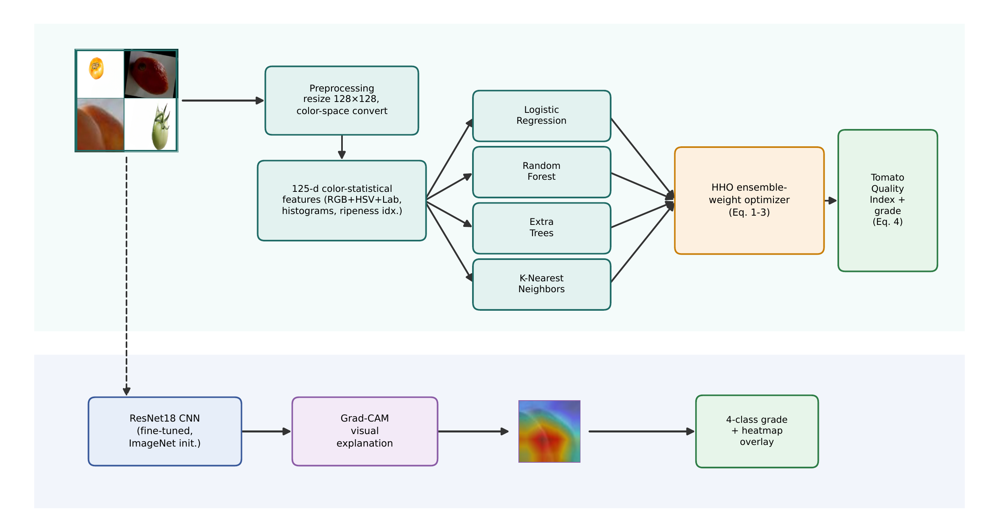
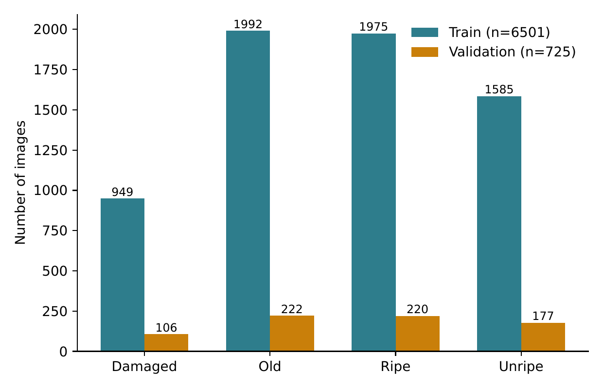
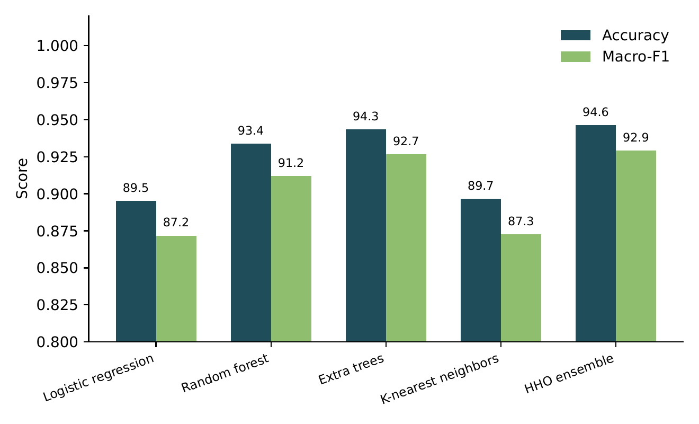
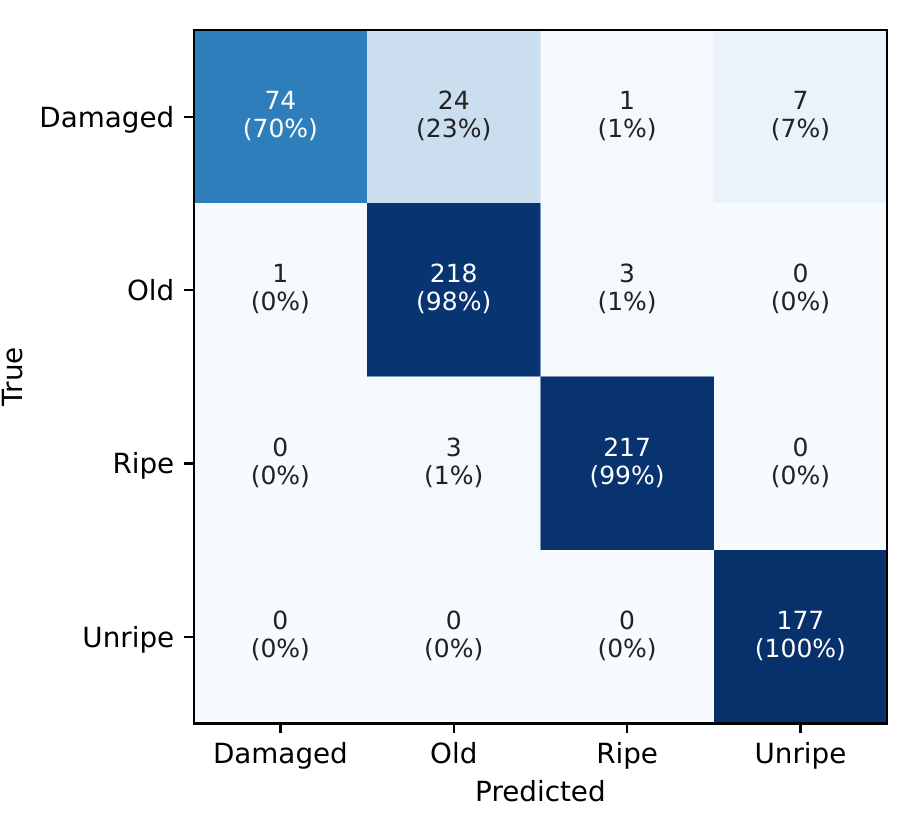
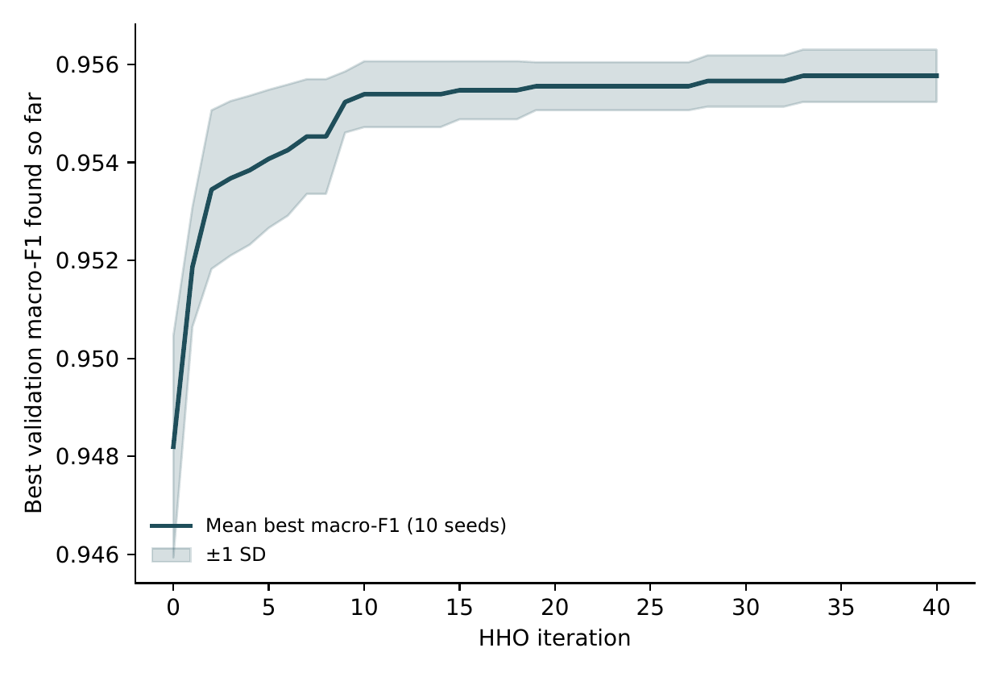
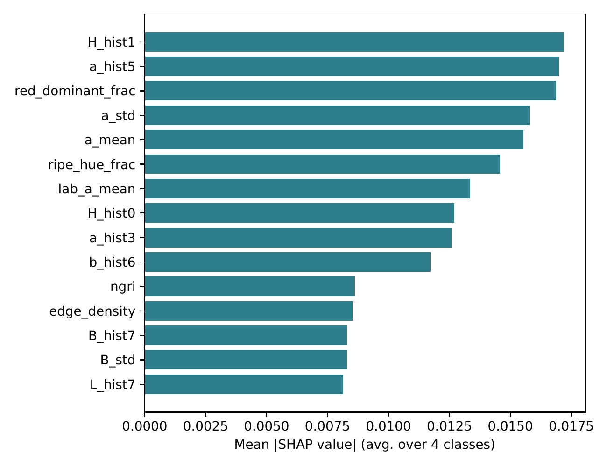
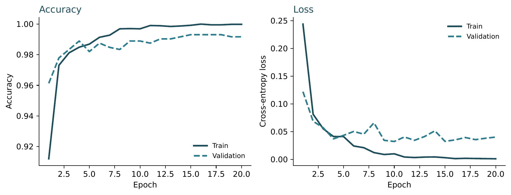
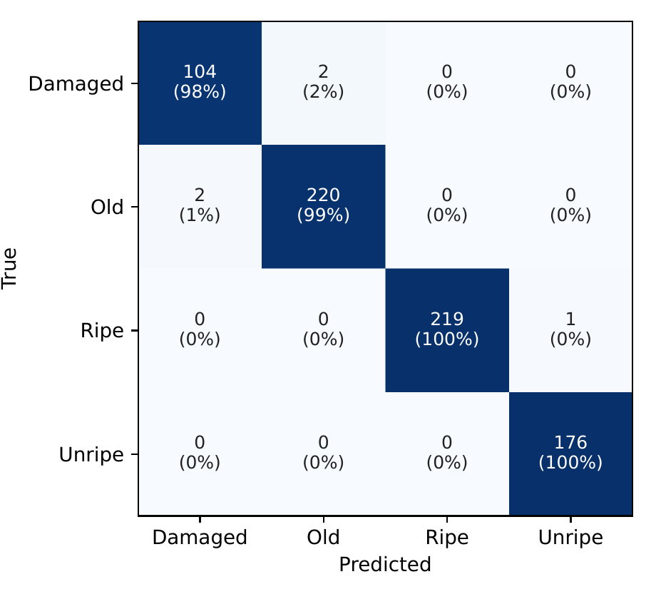
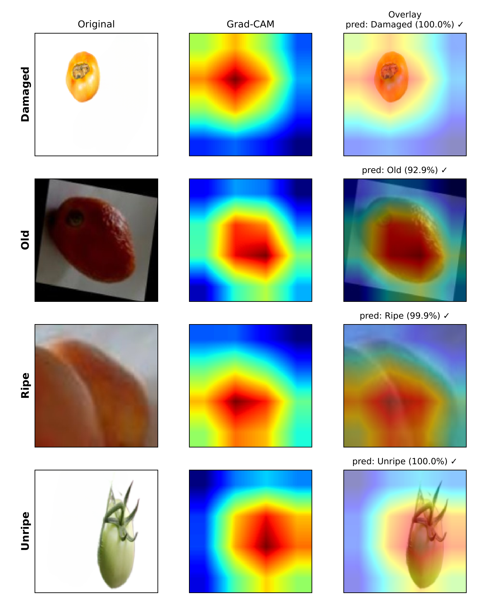

<div align="center">

# HHO-Tomato-Quality-Index

**Harris Hawks Optimization – Optimized Explainable Quality Index for Tomato Grading**

Van Van Chau<sup>1,2</sup> · Phayung Meesad<sup>2,*</sup> · Minh Tuan Nguyen<sup>1</sup>

<sup>1</sup> Faculty of Information Technology, Posts and Telecommunications Institute of Technology, Ho Chi Minh City, Vietnam<br>
<sup>2</sup> Department of Information Technology Management, King Mongkut's University of Technology North Bangkok, Thailand<br>
<sup>*</sup> Corresponding author

*Journal of Data Science and Intelligent Systems* (Bon View Publishing), manuscript #11565, 2026


| HHO-XQI accuracy | Macro-F1 | vs. extra trees alone | ResNet18 CNN accuracy | Training time, XQI vs. CNN |
|:--:|:--:|:--:|:--:|:--:|
| **94.62%** | **92.90%** | p = 0.071, not significant | **99.31%** | **3.92 s** vs. 575.7 s |

</div>

---

**Contents:**
[Summary](#summary) ·
[Figures](#figures) ·
[Tables](#tables) ·
[Repository structure](#repository-structure) ·
[Reproduction](#reproduction) ·
[Data](#data) ·
[Citation](#citation)

This repository holds the code, extracted features, trained CNN weights, result files, run logs, tables and figures for the manuscript. Every archived result file is reproduced exactly by the logged reruns in `logs/`.

---

## Summary

Automated tomato ripeness and quality grading replaces slow, subjective manual sorting on packing lines. Most reported systems, however, rely on heavy deep networks or on a single accuracy figure, with no ablation, no statistical validation and no explicit accuracy–interpretability–latency trade-off.

**HHO-XQI** is a Harris Hawks Optimization–optimized Explainable Quality Index for four-class grading: Damaged, Old, Ripe and Unripe.
- It extracts **125 interpretable RGB/HSV/Lab color-statistical descriptors**.
- It fuses **four base learners** (logistic regression, random forest, extra trees, k-nearest neighbors) through HHO-optimized soft voting.
- It turns the fused output into a continuous **Tomato Quality Index (TQI)**.
- It is benchmarked against a fine-tuned **ResNet18 CNN with Grad-CAM**.

On the 725-image held-out validation split, HHO-XQI reaches **94.62% accuracy** and **92.90% macro-F1**.
- **Significance:** it significantly beats three of the four baselines (p < 10⁻⁴) but **not extra trees alone** (p = 0.071).
- **CNN comparison:** the CNN reaches 99.31% accuracy at comparable CPU latency (11.31 vs. 12.05 ms) but needs about **147× longer training** (575.7 vs. 3.92 s).

These findings support a two-tier deployment. HHO-XQI serves as a near-instantly retrainable, SHAP-native first-stage screener. The CNN+Grad-CAM branch serves as a slower-to-retrain but more accurate second-stage auditor.

### Contributions

1. **Pipeline:** a complete, reproducible grading pipeline for the four tomato classes, built on 125 interpretable color-statistical descriptors.
2. **HHO fusion and TQI:** HHO jointly optimizes the soft-voting weights of four heterogeneous base learners and builds the **Tomato Quality Index**. The TQI is a continuous, explainable score that ranks samples by predicted grade risk.
3. **Statistical validation:** repeated stratified cross-validation, Holm-corrected Wilcoxon tests, a two-axis ablation, HHO sensitivity and convergence studies, and SHAP attribution.
4. **CNN benchmark:** a fine-tuned ResNet18 CNN with Grad-CAM, trained on the same data as an independent explainability channel and accuracy/latency benchmark. It supports a two-tier industrial deployment scenario.

---

## Figures

<p align="center">
  <br>
  <em><b>Figure 1.</b> System architecture of the proposed framework, with the parallel CNN+Grad-CAM benchmark branch</em>
</p>

<table align="center">
  <tr>
    <td align="center"><br><sub><b>Figure 2.</b> Dataset class distribution by split</sub></td>
    <td align="center"><br><sub><b>Figure 3.</b> Model comparison on the held-out validation split</sub></td>
  </tr>
  <tr>
    <td align="center"><br><sub><b>Figure 4.</b> HHO-XQI confusion matrix, held-out validation split</sub></td>
    <td align="center"><br><sub><b>Figure 5.</b> HHO convergence, mean ± 1 SD over 10 seeds</sub></td>
  </tr>
  <tr>
    <td align="center"><br><sub><b>Figure 6.</b> Top-15 features by mean |SHAP|, extra trees learner</sub></td>
    <td align="center"><br><sub><b>Figure 7.</b> ResNet18 training and validation accuracy and loss</sub></td>
  </tr>
  <tr>
    <td align="center"><br><sub><b>Figure 8.</b> ResNet18 confusion matrix, held-out validation split</sub></td>
    <td></td>
  </tr>
</table>

<p align="center">
  <br>
  <em><b>Figure 9.</b> Grad-CAM: original image, class-activation heatmap and overlay, one sample per class</em>
</p>

Vector PDF versions of all figures are in `figures/`.

---

## Tables

**Table 1.** Positioning of HHO-XQI against the closest related work. ✓ = yes, ✗ = no, ∂ = partial.

| Study | Swarm | Stat. | Abl. | XAI | Multi-branch |
|:--|:--:|:--:|:--:|:--:|:--:|
| Shrivastav et al. | ✓ | ✗ | ∂ | ✗ | ✗ |
| Rajalaxmi et al. | ✓ | ✗ | ✗ | ✗ | ✗ |
| Malini et al. | ✓ | ✗ | ✗ | ✗ | ✗ |
| Quach et al. | ✗ | ✗ | ✗ | ✓ | ✗ |
| Tomas et al. | ✗ | ✗ | ✗ | ✗ | ∂ |
| HHO-XQI, this work | ✓ | ✓ | ✓ | ✓ | ✓ |

**Table 2.** Dataset class distribution

| Class | Train | Validation | Total |
|:--|--:|--:|--:|
| Damaged | 949 | 106 | 1,055 |
| Old | 1,992 | 222 | 2,214 |
| Ripe | 1,975 | 220 | 2,195 |
| Unripe | 1,585 | 177 | 1,762 |
| Total | 6,501 | 725 | 7,226 |

**Table 3.** Held-out validation performance, N = 725

| Model | Acc. | Prec. | Rec. | F1 |
|:--|--:|--:|--:|--:|
| Logistic regression | 0.8952 | 0.8827 | 0.8654 | 0.8717 |
| Random forest | 0.9338 | 0.9449 | 0.8988 | 0.9119 |
| Extra trees | 0.9434 | 0.9525 | 0.9144 | 0.9266 |
| K-nearest neighbors | 0.8966 | 0.8954 | 0.8628 | 0.8727 |
| HHO-XQI | 0.9462 | 0.9551 | 0.9166 | 0.9290 |

**Table 4.** HHO-optimized fusion weights

| Base learner | Fusion weight |
|:--|--:|
| Extra trees | 0.8721 |
| Random forest | 0.0612 |
| Logistic regression | 0.0590 |
| K-nearest neighbors | 0.0077 |

**Table 5.** Repeated cross-validation, 5-fold × 4 repeats, mean ± SD

| Model | Accuracy | Macro-F1 |
|:--|--:|--:|
| Logistic regression | 0.9148 ± 0.0044 | 0.8982 ± 0.0055 |
| Random forest | 0.9488 ± 0.0049 | 0.9365 ± 0.0064 |
| Extra trees | 0.9565 ± 0.0047 | 0.9464 ± 0.0062 |
| K-nearest neighbors | 0.9029 ± 0.0064 | 0.8850 ± 0.0080 |
| HHO-XQI | 0.9551 ± 0.0041 | 0.9442 ± 0.0058 |

**Table 6.** Wilcoxon signed-rank test, HHO-XQI vs. each baseline, 20 paired folds, Holm-corrected

| Comparison | p, raw | p, Holm | Significant at α = 0.05 |
|:--|--:|--:|:--:|
| vs. Logistic regression | 1.9 × 10⁻⁶ | 7.6 × 10⁻⁶ | Yes |
| vs. Random forest | 3.8 × 10⁻⁶ | 7.6 × 10⁻⁶ | Yes |
| vs. K-nearest neighbors | 1.9 × 10⁻⁶ | 7.6 × 10⁻⁶ | Yes |
| vs. Extra trees | 0.0707 | 0.0707 | No |

**Table 7.** Feature-space ablation, HHO-XQI on held-out validation

| Feature set | Dim. | Acc. | F1 |
|:--|--:|--:|--:|
| RGB only | 36 | 0.9186 | 0.8995 |
| RGB + HSV | 72 | 0.9462 | 0.9320 |
| RGB + HSV + Lab, no ripeness indices | 108 | 0.9490 | 0.9352 |
| Full, + ripeness/damage indices | 125 | 0.9462 | 0.9290 |

**Table 8.** Ensemble-composition ablation, leave one learner out

| Configuration | Acc. | F1 |
|:--|--:|--:|
| Without logistic regression | 0.9434 | 0.9266 |
| Without random forest | 0.9393 | 0.9217 |
| Without extra trees | 0.9283 | 0.9093 |
| Without k-nearest neighbors | 0.9393 | 0.9217 |
| Full ensemble, all 4 learners | 0.9462 | 0.9290 |

**Table 9.** HHO hyperparameter sensitivity, 5 seeds per cell, mean ± SD

| Hawks | Iters. | Accuracy | Macro-F1 | Extra-trees weight |
|:--:|:--:|--:|--:|--:|
| 8 | 10 | 0.9418 ± 0.0022 | 0.9246 ± 0.0022 | 0.859 ± 0.137 |
| 8 | 25 | 0.9426 ± 0.0031 | 0.9257 ± 0.0039 | 0.889 ± 0.112 |
| 8 | 50 | 0.9429 ± 0.0027 | 0.9256 ± 0.0036 | 0.884 ± 0.065 |
| 16 | 10 | 0.9421 ± 0.0037 | 0.9246 ± 0.0043 | 0.846 ± 0.079 |
| 16 | 25 | 0.9393 ± 0.0015 | 0.9215 ± 0.0015 | 0.785 ± 0.062 |
| 16 | 50 | 0.9401 ± 0.0026 | 0.9227 ± 0.0031 | 0.788 ± 0.068 |
| 32 | 10 | 0.9443 ± 0.0032 | 0.9270 ± 0.0035 | 0.844 ± 0.055 |
| 32 | 25 | 0.9465 ± 0.0010 | 0.9294 ± 0.0011 | 0.850 ± 0.023 |
| 32 | 50 | 0.9399 ± 0.0039 | 0.9221 ± 0.0043 | 0.770 ± 0.036 |

**Table 10.** Training time, inference latency and complexity per base learner

| Model | Train (s) | Infer. (ms/img) | Complexity |
|:--|--:|--:|:--|
| Logistic regression | 0.24 | 0.0005 | O(m) per sample |
| Random forest | 3.22 | 0.0602 | O(T log n) per sample, T = 300 |
| Extra trees | 0.46 | 0.0526 | O(T log n) per sample, T = 300 |
| K-nearest neighbors | < 0.01 | 0.0157 | O(nm) per sample, brute force |
| Feature extraction | – | 11.93 | per image |
| Full HHO-XQI pipeline | 3.92 | 12.05 | 82.96 images/s, 1 CPU thread |

**Table 11.** HHO-XQI vs. CNN: accuracy, latency and training cost

| Pipeline | Acc. | F1 | Latency (ms) | Train (s) |
|:--|--:|--:|--:|--:|
| ResNet18 CNN + Grad-CAM, CPU | 0.9931 | 0.9918 | 11.31 | 575.7 |
| ResNet18 CNN + Grad-CAM, MPS/GPU | 0.9931 | 0.9918 | 3.22 | 575.7 |
| HHO-XQI, color-statistical, CPU | 0.9462 | 0.9290 | 12.05 | 3.92 |

Tables 2–11 are also provided as CSV files in `results/tables/`.

---

## Repository structure

```
.
├── README.md
├── LICENSE
├── requirements.txt          # scikit-learn pinned to 1.5.2 for exact reproduction
├── code/
│   ├── features.py           # 125-D color-statistical descriptor
│   ├── extract_all.py        # raw images -> features.npz
│   ├── hho.py                # Harris Hawks Optimization: exploration, soft/hard besiege, Levy dives
│   ├── train_baseline.py     # 4 base learners + HHO fusion -> Tables 3-4, Figs 3-4
│   ├── cv_stats.py           # repeated CV + Holm-corrected Wilcoxon -> Tables 5-6
│   ├── ablation.py           # feature-space and ensemble-composition ablation -> Tables 7-8
│   ├── sensitivity.py        # HHO population / iteration sweep -> Table 9
│   ├── convergence.py        # 10-seed convergence study -> Fig 5
│   ├── shap_analysis.py      # SHAP attribution -> Fig 6
│   ├── complexity.py         # training time and latency -> Table 10
│   ├── train_cnn.py          # ResNet18 fine-tuning -> Table 11, Figs 7-8
│   ├── cnn_latency.py        # CNN CPU vs. MPS/GPU latency -> Table 11
│   └── gradcam.py            # Grad-CAM for the CNN branch
├── figure_code/              # regenerates Figures 1-9 from results/ and weights/
├── data/features.npz         # extracted features: train 6,501 x 125, validation 725 x 125
├── weights/cnn_best.pt       # trained ResNet18
├── results/                  # archived result files (*.json) + tables/ (CSV)
├── logs/                     # rerun logs that reproduce results/ exactly
└── figures/                  # Figures 1-9, PDF + PNG
```

## Reproduction

```bash
git clone https://github.com/vancv43/HHO-Tomato-Quality-Index.git
cd HHO-Tomato-Quality-Index
python3 -m venv .venv && source .venv/bin/activate
pip install -r requirements.txt

# Tables 3-9 and Figures 5-6 from the released features (CPU, about 3 minutes)
mkdir -p outputs && cp data/features.npz outputs/
export TOMATO_OUT_DIR="$PWD/outputs"
cd code
python train_baseline.py
python ablation.py
python cv_stats.py
python sensitivity.py
python convergence.py
python shap_analysis.py

# Figures 1-9 from the archived results and the trained CNN
bash ../figure_code/run_all.sh
```

Each run writes its JSON into `outputs/`, where it can be compared with `results/`.

### Reproducibility status

| Item | Source | Status |
|:--|:--|:--|
| Tables 3–9, Figures 3–6 | `logs/*.log` | rerun matches `results/*.json` exactly |
| Table 10 timings | `logs/complexity.log` | complexity values identical; timings are machine-dependent |
| Table 11, Figures 7–8 | `results/cnn_history.json`, `results/cnn_latency.json` | original CNN run; `weights/cnn_best.pt` released |
| Figures 1–9 | `figure_code/` | regenerated from `results/` and `weights/` |

Notes:
- **Library version:** use scikit-learn 1.5.2. Newer releases change the random-forest and extra-trees fits, which shifts the base-learner scores and the fusion weights.
- **Headline configuration:** Tables 3–4 come from `train_baseline.py` as released: 16 hawks, 25 iterations, seed 42, with HHO tuned on a stratified 15% split of the training set.
- **Raw images:** `complexity.py` and `extract_all.py` need the raw images (see Data). Every other analysis runs from `data/features.npz`.

## Data

- **Images:** the Tomatoes Dataset (Damaged / Old / Ripe / Unripe, 7,226 images) is published on Kaggle: https://www.kaggle.com/datasets/enalis/tomatoes-dataset.
  - The images are not redistributed here.
  - Keep the publisher's train/val partition and point `TOMATO_DATA_ROOT` at it (`train/` and `val/`, one folder per class).
- **Features:** `data/features.npz` holds the 125-D features extracted from those images, with labels 0–3 in the order Damaged, Old, Ripe, Unripe.
- **Figure samples:** `figure_code/sample_images/` contains the four validation images shown in Figures 1 and 9.

## Limitations

- Results come from one publisher-defined split of one dataset, photographed under fixed lighting.
- HHO-XQI is not statistically distinguishable from extra trees alone.
- The hand-designed ripeness indices slightly reduce held-out accuracy in the feature ablation (Table 7).

## Citation

```bibtex
@article{chau2026hhoxqi,
  title   = {Harris Hawks Optimization -- Optimized Explainable Quality Index for Tomato Grading},
  author  = {Chau, Van Van and Meesad, Phayung and Nguyen, Minh Tuan},
  journal = {Journal of Data Science and Intelligent Systems},
  year    = {2026}
}
```

## License

Code released under the MIT License. The Tomatoes Dataset is licensed separately by its Kaggle publisher.
